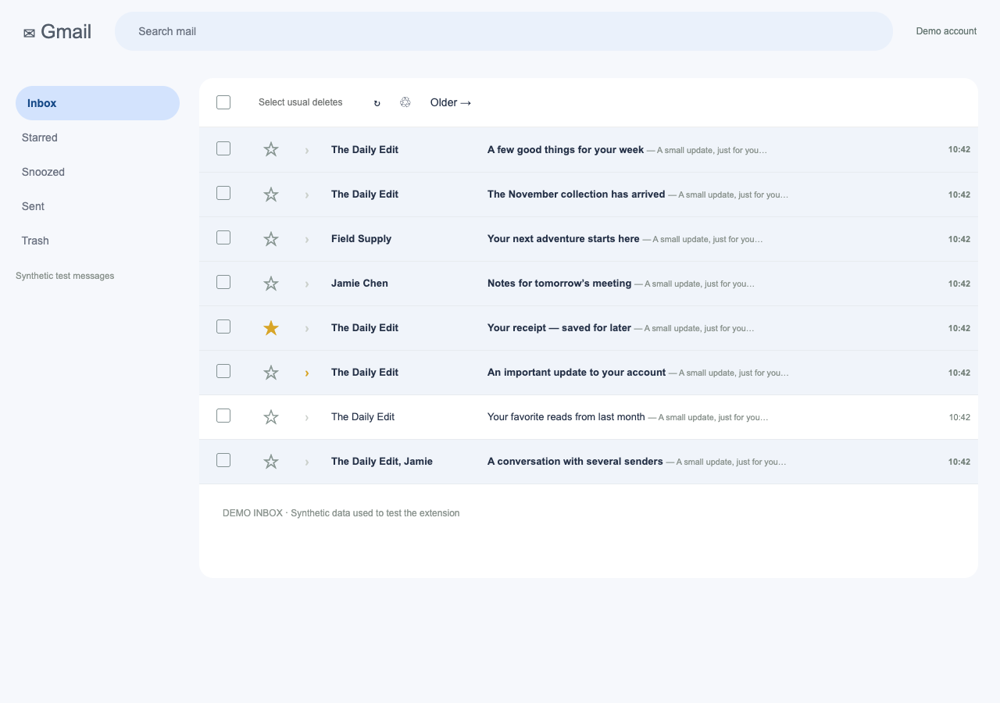

# Usual Delete

A Chrome extension for Gmail that selects unread inbox conversations from senders you tend to delete without reading. You review the selection and use Gmail’s own Delete button.



[Download the latest extension ZIP](https://github.com/andrei930/usual-delete/releases/latest/download/usual-delete.zip) · [Releases](https://github.com/andrei930/usual-delete/releases)

## Version 1.0.2

The selection button now sits in Gmail’s toolbar, between Select all and Refresh. Floating buttons have been removed, and successful selection shows only a brief status message. Open **Settings & learning** from the extension’s Chrome toolbar icon when needed.

To update an existing unpacked installation, replace its folder contents, click **Reload** on its Chrome Extensions card, then refresh Gmail. Its permissions and saved learning are unchanged.

## Install (no build or Google Cloud setup)

1. [Download `usual-delete.zip` from the latest release](https://github.com/andrei930/usual-delete/releases/latest/download/usual-delete.zip) and unzip it somewhere you can keep it. Keep the extension folder in that location after loading it.
2. In Chrome, open **Manage Extensions** from the Extensions menu, or type `chrome://extensions` in the address bar.
3. Turn on **Developer mode** in the upper right.
4. Click **Load unpacked** and select the `usual-delete` folder containing `manifest.json`.
5. Refresh your Gmail tab. The **Select usual deletes** button appears in Gmail’s toolbar, between Select all and Refresh.
6. Open **Usual Delete** from Chrome’s Extensions menu (or its pinned icon), choose **Settings & learning**, then **Learn from Trash**. This scans up to 10 pages of unread conversations in Trash and returns to your previous view. It does not open messages. If you prefer, add a complete sender address under **Manage sender rules** instead.
7. Click **Select usual deletes**. It searches your inbox for qualifying unread mail and selects matching conversations. Review them, then press Gmail’s Delete button yourself.

You can also pin the extension to Chrome’s toolbar and use its popup. No purchase, API key, account connection, or build step is required. This is an unpacked extension, not a Chrome Web Store listing. Chrome or your organization may restrict developer-mode extensions.

## How learning works

- An automatic sender rule requires at least **3 distinct unread conversations in Trash**, and at least **90% deletion evidence** among observed unread deletions and observed opens. Increase the minimum to 5 or 10 in settings.
- A conversation contributes at most one deletion observation and one open observation per sender while its deduplication record is retained. Re-scanning the same Trash does not inflate counts.
- Opening an unread conversation through its message-list row lowers that sender’s confidence. Only clicks that actually navigate from a list into a conversation are counted. Opens through other devices, shortcuts, external apps, or preview panes are not observed.
- The extension also learns while you browse Trash. It does not monitor every delete action in the background. Click **Learn from Trash** again to refresh its view of recent deletions.
- **Always select** enables a sender immediately. **Never select** excludes a sender regardless of the evidence. **Forget sender** removes that sender’s rule, counts, and deduplication records.
- Each Gmail account has separate rules, identified by its email address, rather than the `/u/0` account index. If the active account cannot be identified, actions stop with an explanation.
- Unread-in-Trash is an estimate of “deleted without opening.” Gmail does not expose a complete historical record of opens through its web interface. Messages that you opened and later marked unread can contribute to that estimate. The extension cannot recover mail already permanently deleted or removed by Gmail’s Trash retention policy.
- Learning uses exact, complete sender addresses and skips visible conversations with several different sender addresses. It does not infer meaning from subjects or bodies.

## What one click selects

By default, **Across all result pages** is enabled. The button runs a Gmail search of the following form:

```text
in:inbox is:unread -is:starred -is:important {from:"newsletter@example.com" from:"offers@example.com"}
```

It verifies the visible message rows, selects the eligible ones with Gmail’s own checkboxes, and uses Gmail’s native **Select all conversations that match this search** control when it can positively identify that control. The extension reports whether selection covered all search results or just the current page. It never silently claims to have selected other pages.

If a visible result has multiple senders or a protection marker, selection across pages is skipped and the eligible current-page rows are selected instead. If Gmail’s bulk control cannot be recognized, the panel explains that you can use the native link yourself.

Turn off **Across all result pages** to select only matching unread rows on the current Inbox page without changing the view. Existing selections are cleared before applying the new selection. You can uncheck individual messages or use Gmail’s select-all checkbox to clear the selection.

**Gmail selects conversations.** A matching conversation may include other senders, read messages, or starred/important messages. Gmail’s search operators can match different messages within one conversation, so search exclusions do not guarantee protection of every message in a selected thread. The extension inspects visible rows conservatively; it cannot inspect hidden pages without opening or paging through them. Review before deleting. Turning off Gmail’s conversation view provides finer message-level control.

## Privacy and permissions

- Runs only on `https://mail.google.com/`.
- Uses the `storage` permission and Gmail host access. No broad browsing-history, contacts, identity, or Gmail API permissions.
- Stores sender addresses, per-sender counts and overrides, settings, observation timestamps, and Gmail conversation IDs in `chrome.storage.local` on this Chrome profile.
- Does not read or save message bodies, attachments, or subject lines for learning. No remote AI, analytics, advertising, or extension network requests.
- Data is not placed in Chrome sync storage. Anyone with access to your local browser profile may be able to inspect extension data; it is not encrypted by this extension.
- Reset an account’s learning in the panel with the two-click reset control. Uninstalling removes the extension’s local storage. See [PRIVACY.md](PRIVACY.md).

## Compatibility and limitations

Designed for desktop Gmail in Chrome 109 or newer, using Manifest V3. The initial adapter recognizes Gmail’s standard message-list markup and English/Romanian native bulk-selection and pagination labels. On other interface languages, current-page selection may work, but learning pagination and selection across pages can require manual navigation. Standard single-inbox layout is recommended; unusual multiple-inbox or preview-pane layouts can limit detection.

Gmail does not publish a stable DOM automation contract. Interface changes can require an adapter update; failures produce a visible explanation rather than a delete action. Refresh Gmail after loading or updating the extension. Conversations lacking a detectable sender, stable ID, or supported marker are skipped where that information is needed.

Only the latest 20,000 observation records are retained per account to bound deduplication storage. An extremely old conversation can be counted again after its deduplication record is pruned. The Trash scan is limited to 10 pages per run and stops on navigation or an account change. Searches exceeding 6,500 characters stop with an explanation; use current-page mode or reduce sender rules.

## Development and verification

The extension runs directly from these files; there is no bundler or production dependency.

```sh
npm test
npm install
npx playwright install chromium
npm run test:browser
```

The browser suite launches the actual unpacked extension in an isolated temporary Chromium profile. It intercepts Gmail requests and serves synthetic test messages; it never reads or modifies a live mailbox. Set `CHROMIUM_PATH` to an existing Chromium executable if needed. See [TESTING.md](TESTING.md) for verified scope and remaining limitations.

The implementation follows Chrome’s official [content-script documentation](https://developer.chrome.com/docs/extensions/develop/concepts/content-scripts), [local storage API](https://developer.chrome.com/docs/extensions/reference/api/storage), and [message-passing API](https://developer.chrome.com/docs/extensions/develop/concepts/messaging). Gmail’s search syntax and conversation-level caveat are documented in [Gmail Help](https://support.google.com/mail/answer/7190?hl=en).
